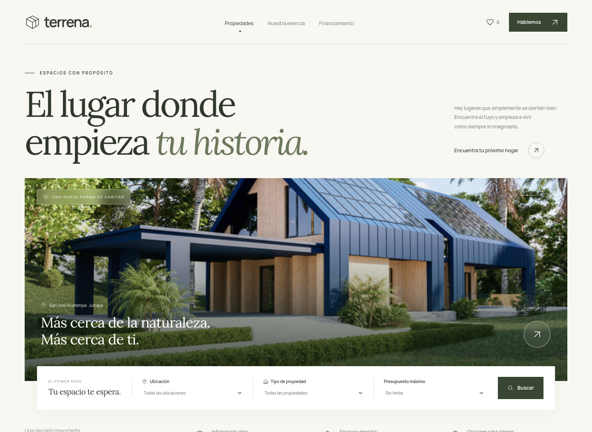

# Terrena · Proyecto terrenos

Aplicación inmobiliaria en **Python + Flask**, con conexión a **Oracle Database** mediante `python-oracledb` y SQLAlchemy. Interfaz en español, adaptable a móvil y escritorio, sin necesidad de Node.js para ejecutarla. Preparada para Visual Studio Code y Oracle SQL Developer.



[Ver la vista móvil](docs/preview-mobile.png)

## Qué incluye

- Catálogo con filtros por ubicación, tipo y presupuesto; fichas con características del inmueble.
- Favoritos persistentes en el navegador.
- Mapa esquemático interactivo inspirado en San José Acatempa, El Copante y El Tablón. Las posiciones son ilustrativas; no es un mapa catastral ni una navegación GPS.
- Calculadora de cuota con enganche, banco y plazo; tasa nominal anual fija y amortización mensual. No incluye seguros, comisiones ni impuestos.
- Registro real de comprador, solicitud de contacto y simulación relacionada con banco e inmueble, en una transacción.
- Modelos para las tablas del diagrama original y las tres nuevas: `banco`, `prestamo` y `caracteristicas_inmueble`.
- Scripts Oracle para SQL Developer, configuración de depuración de VS Code y pruebas automatizadas.

Los inmuebles, fotografías, nombres, ubicaciones, precios y bancos incluidos son **datos de demostración**. Una simulación se registra con estado `Simulacion`, sin desembolso; no equivale a un crédito aprobado. Las solicitudes se guardan en la base configurada, sin enviar correos ni mensajes a agentes.

## Iniciar en Windows con Visual Studio Code

Instala Python 3.12, abre esta carpeta en VS Code e instala la extensión Python de Microsoft.

En la terminal PowerShell, desde la raíz del proyecto:

```powershell
py -3 -m venv .venv
.\.venv\Scripts\python.exe -m pip install -r requirements.txt
Copy-Item .env.example .env
.\.venv\Scripts\python.exe app.py
```

Copia `.env.example` solo si todavía no tienes un `.env` propio. El modo predeterminado, `DB_MODE=demo`, crea una base SQLite en `instance/terrena.db` con seis inmuebles ilustrativos. Permite probar la interfaz antes de configurar Oracle. Consulta la dirección que muestra la terminal y ábrela en tu navegador.

En VS Code, ejecuta **Python: Select Interpreter**, selecciona el intérprete de `.venv` y pulsa **F5**, configuración **Terrena · Python + Oracle**. No necesitas activar PowerShell ni cambiar su política de ejecución.

### Linux / macOS

```sh
python3 -m venv .venv
.venv/bin/python -m pip install -r requirements.txt
# Copia .env.example a .env solo si no existe un archivo propio.
.venv/bin/python app.py
```

## Conectar con Oracle y SQL Developer

**SQL Developer es el cliente de administración; la base de datos debe estar instalada o disponible por red.** Python se conecta a la misma base que tu conexión de SQL Developer. Usa un usuario de aplicación, no SYS/SYSTEM.

En las propiedades de tu conexión de SQL Developer identifica:

| SQL Developer | Configuración de la aplicación |
| --- | --- |
| Usuario | `ORACLE_USER` |
| Contraseña | `ORACLE_PASSWORD`, solo en `.env` local |
| Host, puerto y nombre del servicio | `ORACLE_DSN=host:puerto/servicio` |

En `.env`, cambia `DB_MODE` a `oracle` y completa esos tres campos. Para una instalación local, los servicios habituales son `localhost:1521/XEPDB1` en XE 21c y `localhost:1521/FREEPDB1` en Oracle Free. Usa el servicio que funcione en **tu** SQL Developer; no confundas nombre de servicio con SID. El driver usa el modo **Thin** y no requiere Oracle Instant Client para Oracle 12c o superior.

Nunca compartas contraseñas en el chat ni las subas al repositorio. `.env` está excluido por `.gitignore`. No hay fallback silencioso a SQLite cuando `DB_MODE=oracle`: una conexión Oracle incorrecta genera un error.

### Crear el esquema de la aplicación

El repositorio recibido estaba vacío y no contenía el SQL original. Los modelos reconstruyen las tablas del diagrama y añaden campos de presentación al catálogo: `nombre`, `ciudad`, `descripcion`, `imagen`, `destacado`. La tabla adicional `solicitud` conserva el contacto de una visita sin cambiar los campos originales de `comprador`.

Para una **conexión/esquema nuevo y vacío**, con permiso para crear tablas y cuota de almacenamiento:

1. Abre `sql/oracle/001_esquema_completo.sql` en SQL Developer, selecciona el usuario de aplicación y ejecuta como script con **F5**.
2. Alternativamente, con `.env` configurado, ejecuta `python -m flask --app app init-db` usando el intérprete de `.venv`. No necesitas hacer ambas cosas.
3. Opcionalmente, carga el catálogo ilustrativo con `python -m flask --app app seed-demo`. Conserva el inventario si ya existe.
4. Ejecuta `python -m flask --app app check-db` y después `python app.py`.

En Windows puedes sustituir `python` por `.\.venv\Scripts\python.exe`; en Linux/macOS, por `.venv/bin/python`.

Si solo necesitas las tres tablas solicitadas sobre tu base existente, usa **en su lugar** `sql/oracle/002_solo_tablas_solicitadas.sql`. Requiere `comprador(id_comprador)` e `inmueble(id_inmueble)` con claves compatibles. Si `banco` ya existe con una columna `id`, revisa su estructura y referencias antes de adaptarla a `id_banco`. Este segundo script no prepara todos los campos del catálogo web.

**No ejecutes ambos scripts ni el esquema completo sobre una base existente sin revisar su DDL.** `init-db` crea tablas faltantes, pero no migra columnas existentes. Oracle confirma las sentencias DDL de forma implícita; un fallo posterior no revierte las tablas anteriores. Ningún script contiene `DROP` ni elimina datos.

### Relaciones nuevas

- `prestamo` N:1 `banco`, N:1 `comprador` y N:1 `inmueble`.
- `caracteristicas_inmueble.inmueble_id` es obligatorio y único: cada inmueble puede tener como máximo una fila de características.
- `banco.nit` es único; `banco.nombre` es obligatorio.
- Las referencias impiden eliminar padres relacionados; no se usan borrados en cascada.
- Montos `NUMBER(15,2)` y tasas `NUMBER(7,4)`; las tasas se expresan en porcentaje, por ejemplo `8.5` para 8.5 % anual.

El SQL MySQL entregado inicialmente se conserva en `sql/001_tablas_financiamiento.sql` como antecedente; **no debe ejecutarse en Oracle**.

## Pruebas

Instala las dependencias de desarrollo y ejecuta:

```sh
.venv/bin/python -m pip install -r requirements-dev.txt
.venv/bin/python -m pytest tests/test_api.py -q
```

La suite usa una base temporal SQLite y comprueba catálogo, persistencia real, transacciones, validación, unicidad, claves foráneas y conservación de datos. En Windows usa el ejecutable equivalente dentro de `.venv\Scripts`.

Para ejecutar **la misma suite contra Oracle real**, sin tocar tu esquema personal:

```sh
docker pull gvenzl/oracle-free:23-slim-faststart
.venv/bin/python tests/run_oracle.py
```

El script crea un Oracle Free temporal con credenciales aleatorias en memoria, ejecuta las pruebas y elimina el contenedor y sus volúmenes. Requiere Docker disponible, varios GB de disco y memoria suficientes para Oracle Free. No instala Oracle en tu equipo fuera de Docker.

Las pruebas de cálculo y navegador son opcionales y usan Node.js solo como herramienta de desarrollo:

```sh
npm ci
npm test
npm run test:e2e
```

Las pruebas de navegador requieren Chromium. En Linux se usa `/usr/bin/chromium`; define `CHROMIUM_PATH` con la ubicación de tu navegador si es diferente. Arrancan un servidor de prueba propio y una base separada en `instance/browser-tests.db`.

## Organización

```text
app.py                    Servidor Flask y API
models.py                 Modelos relacionales compatibles con Oracle
database.py               Conexión, modo demo y carga idempotente
data/demo.json            Catálogo ilustrativo
src/                      Interfaz HTML/CSS/JavaScript sin compilación
public/                   Fotografías, mapa, icono y tipografías locales
sql/oracle/               Scripts para Oracle SQL Developer
.vscode/                  Depuración Python con F5
tests/                    API, Oracle, cálculo y navegador
```

La conexión Oracle vive solo en el servidor Python. El navegador consulta `/api/catalogo` y registra formularios en `/api/solicitudes`; nunca recibe credenciales. El precio y la tasa se obtienen en el servidor desde las tablas, no desde los valores enviados por el navegador.

Esta entrega es una aplicación académica/local: no incluye autenticación, panel administrativo ni envío de notificaciones. El historial del navegador guarda una copia de las solicitudes realizadas desde ese dispositivo; limpiarlo no elimina los registros de la base. Los favoritos permanecen en el almacenamiento local. No se incluye una base de datos privada, credenciales ni el inventario real.

## Créditos visuales

Tipografías Manrope y Lora desde Google Fonts, bajo SIL Open Font License (licencias incluidas en `public/fonts`). Fotografías ilustrativas procedentes de los assets públicos de [Realvine, codewithsadee](https://github.com/codewithsadee/realvine), utilizadas como recursos de demostración; sustituir por fotografías propias y verificar sus derechos antes de una publicación comercial. El mapa SVG fue dibujado para este proyecto a partir de la referencia geográfica aportada; no usa mosaicos ni API de Google Maps.
